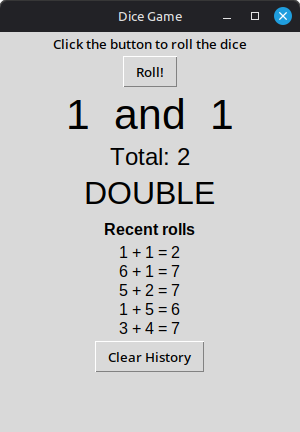

# Python Practice

Small Python programs that practise the fundamentals: loops, lists, functions, user input, character codes and a simple window-based (GUI) game. Each one is short enough to read in a few minutes.

## What's in here

| File | What it does | Practises |
| --- | --- | --- |
| `message_bot.py` | Turns a message into a list of numbers and back again | `ord()`, `chr()`, loops, lists, functions, input checking |
| `dice_roll.py` | A dice game in a window: click Roll to roll two dice, with a running history of recent rolls | `tkinter`, buttons and labels, functions, lists, `random` |
| `exercises/loops.py` | A menu of four loop exercises (counting, times tables, multiples of 13) | `for` loops, `range()`, `%`, input checking |
| `exercises/ascii_names.py` | Shows the ASCII code of every character in two names | `ord()`, list comprehensions |

## How to run

You need Python 3. The terminal programs have nothing to install.

The dice game uses `tkinter`, which comes with the standard Python installers on Windows and macOS. On Linux (including Linux Mint) you may need to install it first:

```bash
sudo apt install python3-tk
```

Then:

```bash
git clone git@github.com:playfu1-d0ubt/python-practice.git
cd python-practice
python3 message_bot.py
python3 dice_roll.py
python3 exercises/loops.py
python3 exercises/ascii_names.py
```

## Dice game

Click **Roll!** to roll two dice. The window shows each die and the total, and says **DOUBLE** when both dice match. The last five rolls are listed under "Recent rolls", newest first, and **Clear History** empties the list.



## Message bot example

`message_bot.py` encodes text into character codes, and decodes the same numbers back into text:

```
1 to encode, 2 to decode, 0 to exit
:1
Enter your secret message: Hi
Encoded: 72, 105

1 to encode, 2 to decode, 0 to exit
:2
Enter the numbers, separated by commas: 72, 105
Decoded: Hi
```

The terminal programs check their input, so typing letters where a number is expected gives a message and asks again instead of crashing.

## Notes

- Most of these started as early practice exercises that I later tidied up: clearer names, comments, input checking and small bug fixes.
- The dice game was built in stages: first a button that rolls one die, then two dice with a total, then the roll history, then the DOUBLE message and the Clear History button.
- ASCII codes only cover basic characters, but `ord()` works with any character, so accented letters like `é` are handled too.
